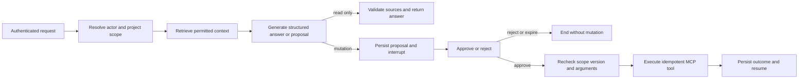

# Task Manager AI design

## Responsibilities and limits

The Python AI Engine provides a task assistant through FastAPI and LangGraph. It retrieves authorized work and project documents, explains answers with sources, and proposes task changes. A model never determines access rights or grants its own tool authority. Writes require explicit approval in the product-agent flow.

The required curriculum includes tool calling, MCP, graph state, persistence, short- and long-term memory, ingestion, retrieval, evaluation, security, latency, and cost. Multi-agent design is an optional comparison after the single-agent baseline, not a prerequisite or a promise to cover every future AI technique.

## Graph and run states

Run states are `queued`, `running`, `awaiting_approval`, `executing`, `completed`, `rejected`, `expired`, `failed`, and `cancelled`. A run belongs to one user, conversation, workspace, and selected project. Other project scopes require a new run. Use a per-run lease to prevent concurrent resume workers.

Separate deterministic nodes for authorization, schema validation, approval validation, and tool execution from model-driven planning. Bound each run to eight model/tool planning iterations, a configurable token budget, and a two-minute active-execution deadline; waiting for approval is outside that active deadline. Default proposal expiry is 15 minutes. Fail safely with a resumable explanation when budgets are reached.

LangGraph's [interrupt and persistence mechanisms](https://docs.langchain.com/oss/python/langgraph/interrupts) support waiting for external input. Keep side effects out of code that may run again before an interrupt; graph replay does not itself make remote writes idempotent.

## Approval and execution ledger

An approval record binds actor, run ID, tool name/version, canonical argument digest, target IDs, expected resource versions, expiry, and decision. Show the exact intended changes and material effects. The authenticated owning user approves or rejects an existing record; submitting altered arguments is not an approval update. The model cannot access the approval endpoint or manufacture a signed decision.

The execution key is derived from the immutable approval ID. A transaction changes approved intent into an execution ledger entry before invoking the tool. On execution, recheck user permission, target state, proposal expiry, and expected version. Changes produce a conflict and a new proposal, never silent approval reuse. A repeated approval/resume returns the existing execution status.

If the process dies after a remote write but before checkpointing, retry the same tool with the same idempotency key and arguments and persist the replayed result. Do not issue a new key. If the remote deduplication retention has expired or the result cannot be established, mark the execution `outcome_unknown`, block automatic retries, and reconcile through canonical resource/audit reads. A checkpoint is not a cross-service transaction.

## Storage and memory

PostgreSQL holds checkpoints through the supported LangGraph adapter plus separate run/approval/job ledgers. MongoDB holds conversation content, extracted documents, and structured long-term memory. Qdrant holds replaceable embeddings. [Data design](DATA.md) defines lifecycle coordination and deletion tombstones.

Short-term memory is the current conversation and bounded graph state. Apply token-window limits and summaries with source dependencies; a summary cannot preserve access after a source is revoked. Long-term memory initially stores explicit user preferences, such as preferred task ordering, only after user opt-in. Do not silently infer/store sensitive personal facts. Scope memory by owner, record provenance and timestamps, and provide inspect/delete APIs. Semantic memory retrieval must still filter by the owner.

## Document ingestion and RAG

1. Authenticate the user and confirm project write permission; validate the upload as UTF-8 text/Markdown up to 1 MiB.
2. Save a staged original through the storage port and create a durable job/lifecycle record; return `202` with progress.
3. Celery extracts/normalizes text, chunks it deterministically, records content versions, obtains embeddings, and upserts scoped vectors. Job state advances only after each durable stage succeeds.
4. For a query, resolve current project access, query only matching workspace/project and index generation, and retrieve candidate references.
5. Recheck each candidate's project permission and current source version/deletion state before including text in a prompt. Query Task for current canonical task content; never answer from a deleted stale snapshot.
6. Return source IDs and version-aware citations. If sources do not support the answer, state uncertainty rather than inventing a task or document.

Begin with fixed chunks of approximately 500 tokens with 75-token overlap, retrieve eight candidates and retain at most five authorized excerpts. These are experimental defaults, recorded with embedding model and prompt version. Compare chunking, hybrid retrieval, and reranking against the same fixture set before adopting them.

Task/project events update AI's derived task corpus; project document content remains AI-owned. Document edits replace a generation; physical vector deletion may lag but authoritative tombstones immediately block disclosure. [Qdrant multitenancy guidance](https://qdrant.tech/documentation/manage-data/multitenancy/) informs payload partitioning; application permission checks remain required.

## Background execution

FastAPI request handlers create durable work and return status; they do not run long ingestion jobs in memory-only background callbacks. Celery uses its supported Redis broker, separate from the NATS business-event bus and from evictable cache Redis. A PostgreSQL job ledger plus reconciliation protects against a lost dispatch. Worker concurrency starts at one to respect the local budget.

Beat schedules ingestion reconciliation and retention maintenance; it does not poll every chat token or replace LangGraph persistence. Run one active Beat scheduler for each schedule set. Set task execution limits and broker visibility timeout consistently with bounded task duration, and make each stage resumable. See [Celery Redis transport](https://docs.celeryq.dev/en/stable/getting-started/backends-and-brokers/redis.html) and [periodic tasks](https://docs.celeryq.dev/en/stable/userguide/periodic-tasks.html).

## Evaluation and acceptance

Maintain a versioned synthetic fixture corpus with at least 30 cases spanning lookup, multi-document questions, missing evidence, wrong project, deleted sources, prompt injection, and proposed updates. Track retrieval recall at five, citation correctness, groundedness, tool selection, argument correctness, and refusal/access isolation separately.

All deterministic security cases must pass: no cross-tenant disclosure, no unapproved mutation, no replayed mutation, and no permission bypass by a document/tool result. Initial live quality targets are at least 80% retrieval recall at five and 90% correct source references on answerable fixtures; report sample size and evaluator method. Do not turn model variability into a flaky unit-test gate.

For each live comparison, record provider/model identifiers, embedding generation, graph/prompt version, fixture revision, input/output tokens, estimated price basis, first-token and completion latency, tool latency, errors, and cache state. Pin the chosen model configuration at evaluation time; no paid provider is selected by this specification. Use a deterministic fake model for CI and core integration tests.

Advance to a multi-agent experiment only after this baseline is measured. Compare quality, extra model/tool calls, latency, failure recovery, and cost against the same cases and document whether the extra coordination is justified.
