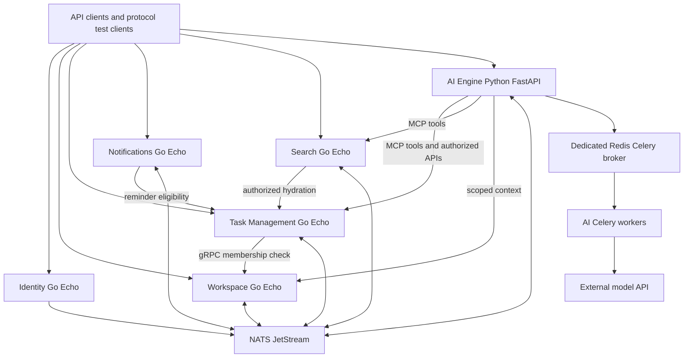

# Task Manager architecture

## Service boundaries

The system has six independently runnable services in one repository. Each service owns its data and migrations. Shared libraries provide technical utilities rather than shared domain entities. No service imports another service's application or domain packages.

| Service | Owned state | Primary dependencies |
| --- | --- | --- |
| Identity | Accounts, credentials, refresh sessions, signing-key metadata | PostgreSQL, Workspace onboarding status over HTTP |
| Workspace | Personal/team workspaces, memberships, invitations | PostgreSQL, NATS; local identity projection from events |
| Task Management | Projects, project ACL, tasks, change history | PostgreSQL; Workspace gRPC for current membership |
| Notifications | Inbox, delivery attempts, pending reminders | PostgreSQL; Task HTTP for reminder eligibility |
| Search | Disposable full-text projection and indexing progress | PostgreSQL; Task HTTP for current access and canonical results |
| AI Engine | Conversations, documents, memories, runs, approvals, ingestion jobs | PostgreSQL for run integrity/checkpoints; MongoDB, Qdrant, model API; authorized product APIs/MCP |

Workspace onboarding is not an Identity-to-Workspace write transaction. Identity commits account creation and an outbox event. Workspace provisions the personal workspace with a uniqueness constraint on the owner; clients can poll onboarding status without repeating registration. Identity only reads Workspace for that status endpoint after the account already exists.

There is no generic `Core` service or standalone authorization service. Workspace owns workspace roles; Task owns project ACL. Policy evaluation is part of the owning application's use cases. AI Assistant and AI Engine are one Python service with separate API and worker processes. Workers are deployment units, not additional domain services.

## Container view

Each stateful service connects only to its owned databases; storage edges are omitted for readability. Infrastructure is private to the container network. Local APIs bind to loopback. A future edge proxy may route traffic, but authorization remains in the service receiving the operation.

## Hexagonal structure

The target Go layout uses `cmd/<service>` for composition and `internal/<service>/{domain,application,ports,adapters}` for implementation. Adapters contain inbound HTTP/gRPC/MCP/event handlers and outbound persistence, messaging, and remote clients. Python follows equivalent packages within `services/ai`. Migrations are grouped by owning service; machine-readable contracts live under `contracts/`.

Dependencies point inward: adapters implement ports; application use cases depend on domain and ports; domain depends on neither Echo nor database/client types. Inbound adapters authenticate, decode, and map errors. Application use cases enforce business rules and authorization for every adapter, including background jobs. Persistence adapters own SQL and transaction handling. Composition roots own wiring and lifecycle.

The current `usersapp` scaffold is an input to slice S01, not a second architecture. Its `Password` entity field must not become an API response or stored plaintext credential. Move useful code incrementally when implementation starts; no source relocation is part of this documentation change.

## Communication and consistency

HTTP serves product operations. gRPC serves Workspace membership checks with a deadline and authenticated service identity. HTTP and gRPC receive end-user context as validated, audience-specific credentials; caller-supplied user ID headers are never sufficient.

NATS JetStream carries durable business events and targeted work commands. An event describes a committed fact; a command requests work from one owning consumer group. The default is at-least-once processing. Business writes and outbox rows commit in one database transaction; consumers persist their effects and inbox deduplication record before acknowledging. See [contracts](CONTRACTS.md) for retry and ordering.

No distributed database transaction is required. Signup onboarding, invitation delivery, reminders, and indexing each expose pending or failed states and can be retried or reconciled. The system does not claim global ordering or end-to-end exactly-once execution.

## Main flows

### Create and assign a task

1. Task verifies the access token, reads its project, and asks Workspace for current active membership and role.
2. Task applies project ACL and verifies the assignee's membership, then commits task, audit record, and outbox event.
3. The relay publishes the event and records publication. A crash between publication and recording may produce a duplicate.
4. Notifications records one assignment notification; Search updates its projection. Failure of either consumer does not roll back the task.
5. Live delivery tells the client to refresh its authoritative inbox; a missed socket message does not lose the notification.

### Revoke access

Workspace removal changes the authoritative membership immediately. Subsequent Task operations query Workspace rather than trusting cached token roles. Search and AI use canonical permission checks before returning retrieved content. Events invalidate derived state, but are not the security boundary. In-flight requests authorized before removal may complete; no distributed linearizable revocation guarantee is claimed. See [security](SECURITY.md) for stream and cache handling.

### Execute an AI proposal

The graph reads permitted context, creates a structured proposal, checkpoints, and waits. Approval creates durable execution intent tied to the user, arguments, and resource version. The tool checks current access and idempotency; the result is persisted before the run advances. Restarting or resuming a run cannot silently approve a different action. [AI design](AI.md) defines recovery from an ambiguous tool result.

## Dependency failures

| Failure | Behavior |
| --- | --- |
| Workspace unavailable | Protected Task operations fail closed with retryable unavailability; no cached allow |
| NATS unavailable | Authoritative writes can commit with an outbox backlog until configured storage/backlog limits; relays retry |
| Search unavailable or behind | Direct project/task operations work; search reports lag or unavailability |
| Cache Redis unavailable | Data cache falls back to PostgreSQL within concurrency limits; security controls use their defined fail-closed policy |
| Celery broker or worker unavailable | AI ingestion remains queued in the durable job ledger and reconciliation restores dispatch |
| MongoDB or Qdrant unavailable | Dependent AI features report unavailability; core task management continues |
| Model timeout | Bound retries; preserve run state and report interruption without replaying completed mutations |
| Telemetry backend unavailable | Bounded export queues drop telemetry rather than blocking product requests |

## Deployment progression

Compose starts only the dependencies needed by a slice. Service processes are stateless apart from explicit mounted volumes and owned stores; they accept configuration externally, report health, close pools cleanly, and drain work on shutdown. Local file storage for document originals is behind a storage port so a later object store requires an adapter rather than domain changes.

Kubernetes follows working Compose flows: Deployments for APIs/workers, Jobs for migrations, CronJobs for maintenance, and explicit stateful storage. CI/CD comes after those exercises. See [operations](OPERATIONS.md) and [ADR index](adr/README.md).
